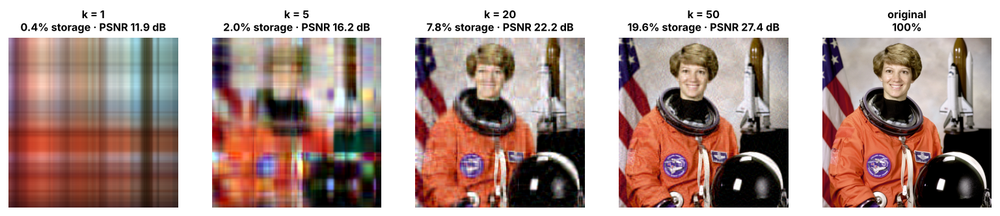
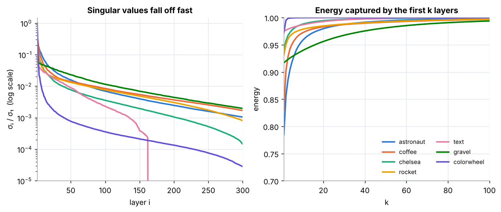
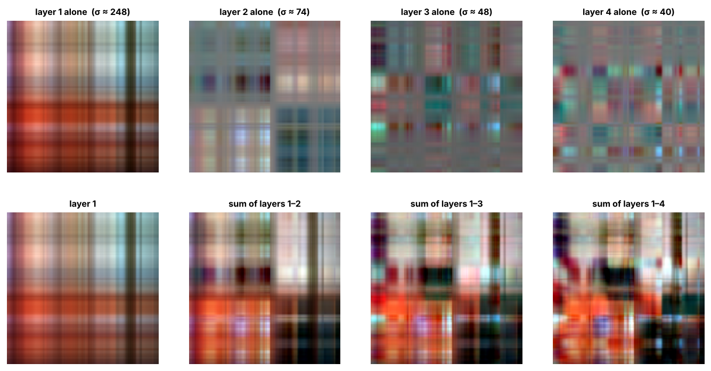
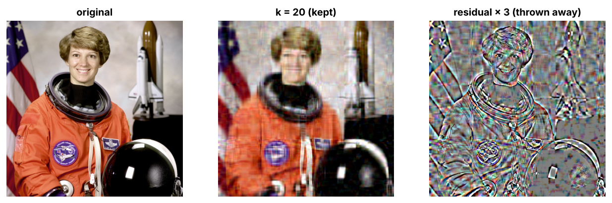
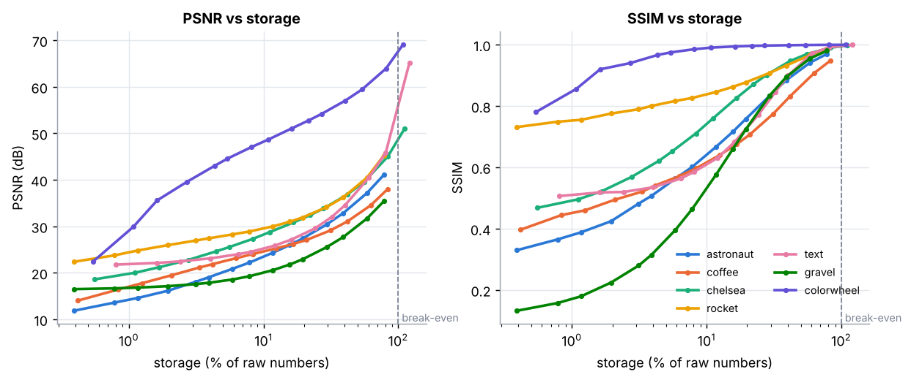
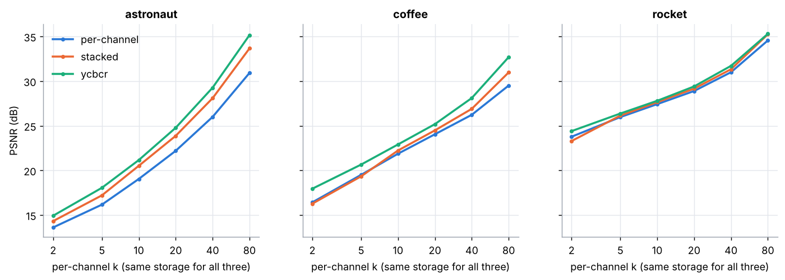
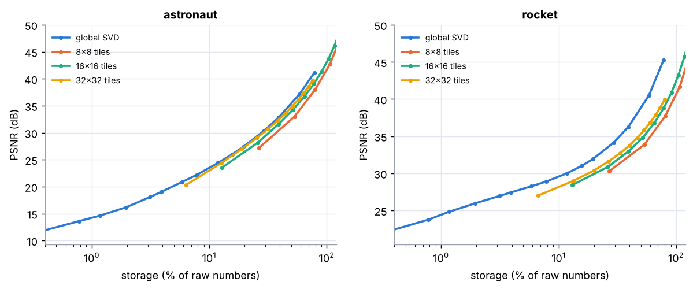
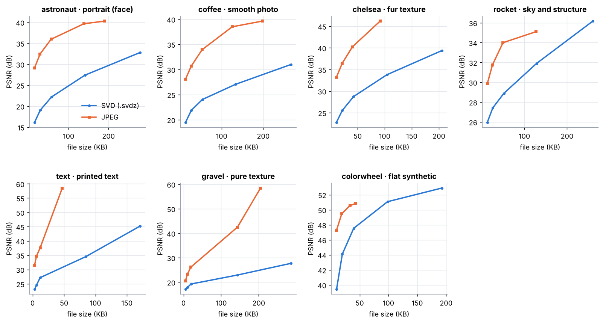
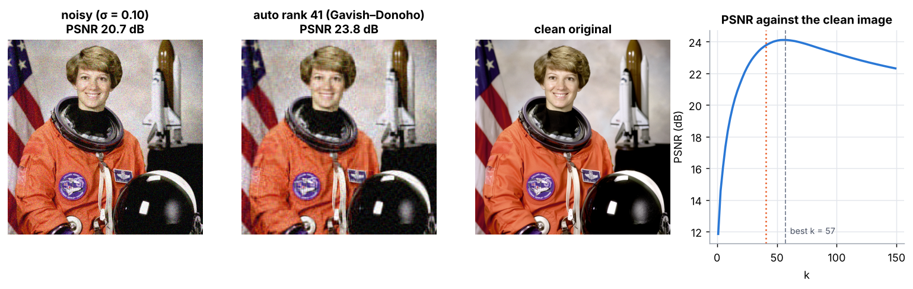
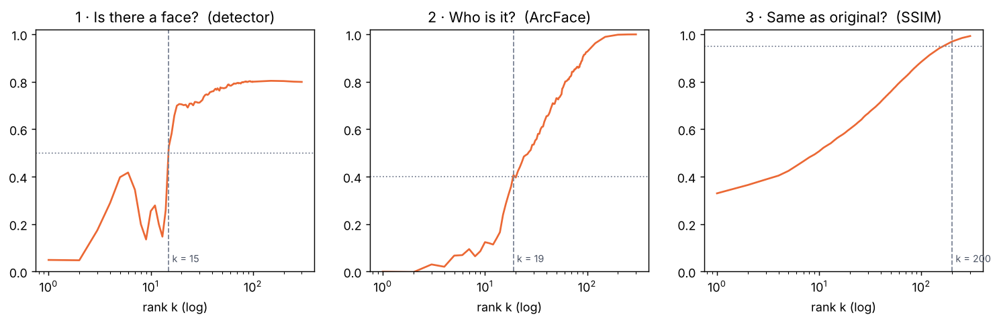

# SVD Compression MARK I

**Compress photos with the singular value decomposition, see exactly what you lose, and find out whether people and machines agree on when a compressed face becomes recognisable.**

[**▶ Live demo**](https://nithisvraja-droid.github.io/svd-compression-MARK-I/) — drag a slider, upload your own photo, watch the layers add up. Runs in the browser.
[**▶ Human-vs-machine test**](https://nithisvraja-droid.github.io/svd-compression-MARK-I/benchmark/) — 3 minutes, tells you your own thresholds.



## The idea in one paragraph

A colour photo is three matrices (red, green, blue). The SVD writes each one as a sum of rank-one layers

```
A = σ₁·u₁v₁ᵀ + σ₂·u₂v₂ᵀ + … + σᵣ·uᵣvᵣᵀ      with σ₁ ≥ σ₂ ≥ … ≥ 0
```

Keeping only the first *k* layers gives the best possible rank-*k* approximation (Eckart–Young–Mirsky theorem). One layer costs *m + n + 1* numbers instead of *m × n*, so a 512 × 512 photo needs 1,025 numbers per layer instead of 262,144 per channel.

## What's in here

| Feature | Where |
|---|---|
| Truncated SVD compression, storage maths, energy, break-even rank | `svdlab/core.py` |
| Numerical proof of Eckart–Young (error = √(σ²ₖ₊₁ + …) and σₖ₊₁) | `results/02_eckart_young.csv` |
| Randomized SVD (Halko–Martinsson–Tropp), over 20× faster for small *k* | `svdlab/core.py` |
| Three colour strategies at equal storage: per-channel RGB, stacked `[R G B]`, YCbCr | `svdlab/colour.py` |
| A real file format, `.svdz`, with 8-bit quantised factors | `svdlab/codec.py` |
| Block SVD on 8×8 / 16×16 / 32×32 tiles | `svdlab/blocks.py` |
| Fair comparison with JPEG at the same file size | `svdlab/jpeg.py` |
| Denoising with an automatic rank (Gavish–Donoho optimal threshold) | `svdlab/denoise.py` |
| Seven test images, from flat graphics to pure texture | `svdlab/datasets.py` |
| Machine "eyes": SCRFD face detector + ArcFace face recognition | `svdlab/faces.py` |
| Human perception test (method of limits + 2-alternative forced choice) | `docs/benchmark/` |
| Interactive browser demo with its own JavaScript SVD | `docs/index.html`, `docs/svd.js` |
| Command-line tool | `python -m svdlab …` |
| Tests + GitHub Actions CI | `tests/`, `.github/workflows/` |

## Quick start

```bash
git clone https://github.com/nithisvraja-droid/svd-compression-MARK-I.git
cd svd-compression-MARK-I
pip install -r requirements.txt

python -m svdlab info photo.jpg                 # spectrum summary + break-even ranks
python -m svdlab compress photo.jpg --k 50      # -> photo_k50.svdz + photo_k50.png
python -m svdlab compress photo.jpg --psnr 30   # smallest k that reaches 30 dB
python -m svdlab compress photo.jpg --energy 0.99
python -m svdlab decompress photo_k50.svdz

python scripts/run_experiments.py               # every figure and table below (~1–2 min)
python scripts/fetch_models.py                  # face models, ~15 MB, research use only
python scripts/machine_benchmark.py             # machine side of the benchmark
python -m pytest                                # tests
```

```python
from svdlab import compress, decompose, energy
from svdlab.metrics import psnr

rec = compress(img, k=20)          # img: H×W×3, uint8 or float in [0, 1]
print(psnr(img, rec))
```

## Results

All numbers come from `scripts/run_experiments.py`; the CSVs are in [`results/`](results/).

### 1. Why a few layers are enough



Singular values fall by two to three orders of magnitude within the first few dozen layers. How fast depends on the picture:

| Image | Kind | k for 99% energy | k for 99.9% energy | Break-even k |
|---|---|---:|---:|---:|
| colorwheel | flat synthetic | 2 | 4 | 185 |
| chelsea | fur texture | 13 | 71 | 179 |
| text | printed text | 15 | 55 | 124 |
| astronaut | portrait | 36 | 129 | 255 |
| rocket | sky and structure | 38 | 153 | 255 |
| coffee | smooth photo | 42 | 177 | 239 |
| gravel | pure texture | 77 | 204 | 255 |

"Energy" flatters SVD: the first layer is mostly the average colour, so even a blurry blob scores 80–97%. That is why we also measure PSNR, SSIM and human judgement.

### 2. What each layer looks like, and what gets thrown away



Every layer is an outer product (a column pattern times a row pattern), so single layers look like plaid. The residual shows that truncation removes edges and fine texture first:



### 3. Quality vs storage on seven images



The flat colour wheel reaches almost 40 dB with under 3% of the numbers; gravel needs about half of them just to reach 30 dB. **SVD suits images with large smooth regions and fails on texture.**

### 4. Colour: YCbCr beats plain RGB at the same storage



Average PSNR over six budgets:

| Image | per-channel RGB | stacked [R G B] | YCbCr (60% of layers on brightness) |
|---|---:|---:|---:|
| astronaut | 21.3 dB | 22.9 dB | **23.9 dB** |
| coffee | 22.9 dB | 23.4 dB | **24.6 dB** |
| rocket | 28.6 dB | 28.8 dB | **29.2 dB** |

Human eyes see brightness detail far better than colour detail, so spending layers on brightness pays off. JPEG uses the same trick.

### 5. Counting numbers is not the same as counting bytes

Pixels are 1-byte integers; numpy's SVD gives 8-byte floats. A float64 SVD at k = 50 for the astronaut is **1.23 MB, bigger than the 0.79 MB raw image**. Quantising U and V to 8 bits (`.svdz`) shrinks it to **144 KB** and costs **less than 0.16 dB** of PSNR in every case we tested ([`results/06_quantisation.csv`](results/06_quantisation.csv)).

### 6. Block SVD does not help here



At equal storage, one global SVD matched or beat 8×8, 16×16 and 32×32 tiles on both images. Small tiles spend too much on the per-tile vectors.

### 7. Honest comparison: JPEG wins



At the same file size, JPEG is **3 to 20 dB better (median 8.8 dB)** on every image. JPEG combines a fixed frequency basis (DCT) with entropy coding and perceptual quantisation; SVD has to store its own basis vectors for every image. SVD is a beautiful way to understand compression, not a replacement for JPEG.

### 8. Bonus: SVD removes noise



Noise spreads thinly over all singular values while the picture lives in the first few. With σ = 0.10 Gaussian noise, the automatic Gavish–Donoho rank (k = 41–43) lifts PSNR from **20.7 dB to 23.8 dB**, close to the best possible 24.1 dB at k = 57.

### 9. Bonus: randomized SVD

For an 872 × 1000 matrix, randomized SVD gets the top 10 layers **more than 20× faster** than a full SVD (exact timing varies by machine) with 0.1% more error, and the top 100 about 3× faster with 1.1% more error ([`results/10_randomized_svd.csv`](results/10_randomized_svd.csv)).

## Human vs machine: when does it become a face?

Pixel metrics say nothing about *recognition*, so the benchmark splits it into three questions and asks both people and models:

| Question | Machine measure | Machine threshold (astronaut) | Storage |
|---|---|---:|---:|
| Is there a face? | SCRFD detector confidence ≥ 0.5 | k = 15 | 5.9% |
| Who is it? | ArcFace similarity to the original ≥ 0.40 | k = 19 | 7.4% |
| Same as the original? | SSIM ≥ 0.95 | k = 200 | 78% |



On the portrait used in our course slides the same pipeline gave k = 7, 13 and 120. The detector is not monotonic: on the astronaut it briefly rises at k = 5–6, drops, then locks on at k = 15.

**Human side:** [take the test](https://nithisvraja-droid.github.io/svd-compression-MARK-I/benchmark/). Part 1 reveals the photo layer by layer (method of limits); Part 2 asks "which is the original?" 24 times (two-alternative forced choice). Each run ends with a result code. Collect codes in a text file and run

```bash
python scripts/analyse_human.py codes.txt
```

to get the human thresholds next to the machine ones and `figures/12_human_vs_machine.png`. **Data collection is in progress**: results will be added here.

## Limitations

- One face photo in the benchmark; Part 1 answers are self-reported, not a verified identification.
- Screen size strongly affects Part 2; each run records the display width.
- The face models are InsightFace's `buffalo_sc` pack, licensed for non-commercial research only, and are not included in this repo.
- `.svdz` uses simple 8-bit quantisation plus zlib; smarter coding would narrow, not close, the gap to JPEG.

## Project structure

```
svdlab/            Python package (core, colour, codec, blocks, jpeg, denoise, faces, metrics, CLI)
scripts/           run_experiments.py, machine_benchmark.py, analyse_human.py, fetch_models.py
docs/              GitHub Pages: interactive demo (index.html, svd.js) and benchmark/
figures/ results/  generated outputs
tests/             unit tests (Python) + JavaScript SVD test
REPORT.md          full write-up
```

## Team

Course project for **Mathematics for Intelligent Systems – I**, School of AI, Amrita Vishwa Vidyapeetham, Coimbatore (2026).
Nithis V. R. · Pragna · Dimple · Pavitraa

## References

1. C. Eckart and G. Young, "The approximation of one matrix by another of lower rank," *Psychometrika* 1(3), 1936.
2. G. Strang, *Introduction to Linear Algebra*, 5th ed., Wellesley–Cambridge Press, 2016.
3. N. Halko, P.-G. Martinsson and J. A. Tropp, "Finding structure with randomness," *SIAM Review* 53(2), 2011.
4. M. Gavish and D. L. Donoho, "The optimal hard threshold for singular values is 4/√3," *IEEE Trans. Inf. Theory* 60(8), 2014.
5. Z. Wang et al., "Image quality assessment: from error visibility to structural similarity," *IEEE Trans. Image Process.* 13(4), 2004.
6. J. Deng et al., "ArcFace: Additive angular margin loss for deep face recognition," CVPR 2019.
7. J. Guo et al., "Sample and computation redistribution for efficient face detection" (SCRFD), ICLR 2022.
8. G. K. Wallace, "The JPEG still picture compression standard," *IEEE Trans. Consumer Electronics* 38(1), 1992.

Test images from [scikit-image](https://scikit-image.org/docs/stable/api/skimage.data.html). Code released under the MIT License.
